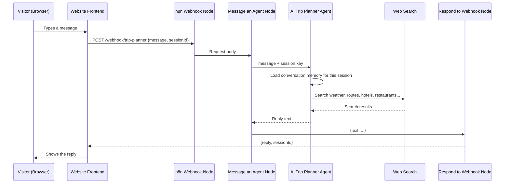

# AI Trip Planner (n8n Agent + Webhook Workflow)

An AI travel planner built on **n8n**. A visitor chats with it on a trip-planning website. The assistant collects the trip details, searches the web for current information, and returns a complete day-by-day travel plan. The plan includes weather, routes and distances, places to visit, hotels, restaurants, cost estimates and booking links.

The project has two parts:

1. **AI Trip Planner agent**: the "brain". It holds the instructions, the AI model, memory and web search.
2. **AI Trip Planner - Website Webhook workflow**: the "doorway". It gives the agent a public HTTP endpoint that a website can call.

---

## Table of contents

- [Architecture](#architecture)
- [Part 1: The AI Trip Planner agent](#part-1-the-ai-trip-planner-agent)
- [Part 2: Why a workflow is needed](#part-2-why-a-workflow-is-needed)
- [Part 3: How the workflow works](#part-3-how-the-workflow-works)
- [How the agent joins the workflow](#how-the-agent-joins-the-workflow)
- [API reference](#api-reference)
- [Frontend integration example](#frontend-integration-example)
- [Setup and deployment](#setup-and-deployment)
- [Limitations and notes](#limitations-and-notes)

---

## Architecture



In short: **Website → Webhook → Agent → Webhook response → Website**

---

## Part 1: The AI Trip Planner agent

The agent is an **n8n Agent**, a standalone AI assistant managed in n8n. It is a separate object, not a node inside a workflow, and it is published on its own.

### Configuration

| Setting | Value | Purpose |
|---|---|---|
| **Name** | AI Trip Planner | |
| **Model** | `anthropic/claude-sonnet-5` | The LLM that reasons and writes the plan |
| **Model credential** | n8n Gateway credits | Runs the model without a separate Anthropic API key |
| **Web search** | Anthropic native web search, up to 5 searches per turn | Gets real, current information |
| **Memory** | Enabled, stored in n8n, with observational memory | Remembers earlier messages from the same visitor |
| **Prompt caching** | Enabled | Reuses the long system prompt to cut cost and latency |
| **Node tools / skills** | None | All research goes through the built-in web search |

### Tools the agent uses

The agent has **one tool: web search**. It uses the model provider's native web search to look up:

- Weather forecasts (trips within about 10 days) or typical seasonal climate (trips further out)
- Driving or travel distances and times between locations
- Top attractions along the route and at the destination
- Real hotels and guesthouses, with official or booking-site links (Booking.com, Agoda, Airbnb, Expedia, TripAdvisor)
- Well-reviewed restaurants, with Google Maps, TripAdvisor or official links
- Transport booking options (trains, buses, flights, car rental)
- Entry fees and typical prices, for cost estimates

The instructions forbid the agent from inventing URLs, prices, ratings or business names. It may only include links it actually found in search results.

### Memory

Each visitor conversation is identified by a **session key**. Within one session, the agent remembers what the visitor already said, such as dates, destination, group size and budget. That way it doesn't ask again, and it can change the plan later ("make it cheaper", "add one more day").

### How the agent behaves (conversation flow)

The agent follows a three-phase process defined in its system instructions.

#### Phase 1: Collect trip details

The agent asks 2-3 questions at a time, so it never feels like a long form.

**Required details**
1. Trip start date (and end date or duration)
2. Number of days
3. Start location
4. Destination(s)
5. Number of travellers (adults / children)
6. Travel mode (car, bus, train, flight, motorbike, mixed)

**Optional details** (the visitor can skip these)
- Budget level or total budget and currency
- Accommodation preference (hotel, guesthouse, villa, hostel)
- Food preferences or dietary needs
- Interests (nature, culture, beaches, adventure, shopping, nightlife)
- Accessibility needs

If the visitor gives several details in one message, the agent picks them out and asks only for what's missing. It asks for clarification if a date is ambiguous or in the past. Before planning, it shows a summary of the details and asks the visitor to confirm.

#### Phase 2: Research

The agent uses web search to base the plan on real, current data.

#### Phase 3: Deliver the plan

The agent returns the plan in clean Markdown with these sections:

1. **Trip overview**: dates, route, travellers, travel mode, total days
2. **Weather**: expected conditions per area, plus a packing list
3. **Route & distances**: each leg with km and travel time, plus the total km
4. **Day-by-day itinerary**: morning, afternoon and evening plans, places to visit, km for the day, where to eat and where to stay
5. **Accommodation options**: 2-3 per overnight stop (budget, mid-range, premium), with prices and links
6. **Restaurants**: cuisine, price range, links
7. **Estimated costs**: a table of transport, accommodation, food, activities and extras, per person and for the group, in local currency and USD
8. **Booking links**: one combined list
9. **Tips**: local advice, safety, best visiting times, required documents

**Rules:** keep days realistic, label prices and weather as estimates to confirm before booking, offer changes after delivering the plan, reply in the visitor's language, and politely decline topics unrelated to travel.

---

## Part 2: Why a workflow is needed

Publishing an n8n Agent makes it live, but **it does not give the agent a public URL**. A published agent can be reached through:

- The built-in n8n preview chat
- Connected chat channels (Slack, Telegram, Discord, Linear)
- **n8n workflows**, using the *Message an Agent* node

A website needs a plain **HTTP endpoint** it can call with `fetch()`. The agent has no such endpoint, so we wrap it in a small workflow that:

1. **Exposes a public URL**: the Webhook node creates `POST /webhook/trip-planner`
2. **Translates the request**: it pulls the visitor's message and session ID out of the HTTP body
3. **Calls the agent**: it forwards the message to the published agent
4. **Returns a clean response**: it sends back a simple JSON object `{ reply, sessionId }`
5. **Handles CORS**: it adds headers so a browser on another domain can call it

Other benefits:
- **Separation of concerns**: you can change the agent's instructions or model without touching the website or the workflow. You can change the API contract without touching the agent.
- **Extensibility**: you can add steps later, such as logging conversations to a database, rate limiting, authentication, or emailing the final plan, without changing the agent.

---

## Part 3: How the workflow works

**Workflow name:** `AI Trip Planner - Website Webhook`

```
[Website Chat Webhook] → [Ask AI Trip Planner] → [Send Reply to Website]
```

### Node 1: Website Chat Webhook (`n8n-nodes-base.webhook` v2.2)

The entry point. It listens for HTTP requests from the website.

| Parameter | Value | Why |
|---|---|---|
| HTTP Method | `POST` | The website sends a JSON body |
| Path | `trip-planner` | Gives the URL `/webhook/trip-planner` |
| Response Mode | `Using 'Respond to Webhook' node` | Holds the HTTP connection open until the agent finishes, then replies with the agent's answer |
| Allowed Origins (CORS) | `*` | Lets browsers on any domain call the endpoint. Restrict this to your own domain in production |
| Authentication | None | Public endpoint |

**Output example**
```json
{
  "headers": { "...": "..." },
  "query": {},
  "params": {},
  "body": {
    "message": "Plan a 3 day trip from Colombo to Kandy for 2 adults by car",
    "sessionId": "visitor-123"
  }
}
```

### Node 2: Ask AI Trip Planner (`n8n-nodes-base.messageAnAgent` v3.1)

This node connects the workflow to the agent.

| Parameter | Value | Why |
|---|---|---|
| Agent Source | Referenced (existing agent) | Uses the published AI Trip Planner agent |
| Agent | AI Trip Planner (by ID) | Which agent to call |
| Message | `{{ $json.body.message }}` | The visitor's text |
| Session ID | Custom key: `{{ $json.body.sessionId \|\| $execution.id }}` | Links the request to the visitor's conversation memory |
| Streaming | Off | The webhook returns one complete JSON response |
| Invoke Mode | Per item | One agent call per incoming request |

**Output example**
```json
{
  "text": "Hello! I'd love to help plan your trip. When are you planning to start...",
  "structuredOutput": null,
  "usage": { "promptTokens": 1842, "completionTokens": 412, "totalTokens": 2254 },
  "toolCalls": [ ... ],
  "finishReason": "stop",
  "session": { "agentId": "...", "sessionId": "visitor-123", "threadId": "..." }
}
```

### Node 3: Send Reply to Website (`n8n-nodes-base.respondToWebhook` v1.5)

Sends the HTTP response back to the website.

| Parameter | Value |
|---|---|
| Respond With | JSON |
| Response Body | `{ "reply": <agent text>, "sessionId": <session id> }` |
| Response Code | 200 |
| Headers | `Access-Control-Allow-Origin: *`, `Content-Type: application/json` |

The node reads the agent's reply from `$json.text`. It gets the session ID from the webhook node with `$("Website Chat Webhook").item.json.body.sessionId`.

---

## How the agent joins the workflow

The agent and the workflow are **separate n8n objects** linked by the **Message an Agent** node:

```
┌────────────────────────── n8n Workflow ──────────────────────────┐
│                                                                  │
│  Webhook  ──►  Message an Agent  ──►  Respond to Webhook         │
│                       │   ▲                                      │
└───────────────────────┼───┼──────────────────────────────────────┘
                        │   │  message + sessionId  /  reply text
                        ▼   │
┌────────────────── n8n Agent: AI Trip Planner ────────────────────┐
│  System instructions • Claude Sonnet model • Web search          │
│  Session memory (per sessionId) • Prompt caching                 │
└──────────────────────────────────────────────────────────────────┘
```

1. The workflow refers to the agent **by its ID**, so it doesn't copy the agent's settings.
2. On each request, the node sends the **message** and a **session key** to the agent.
3. The agent loads the memory for that session, reasons, runs web searches, and writes a reply.
4. The node returns the reply as `text` to the next node in the workflow.
5. Because the agent is only referenced, **any change to the agent (instructions, model, tools) takes effect in the workflow right away**, with no workflow edit needed.

**Why the session ID matters:** HTTP is stateless, so each request arrives on its own. The session ID tells the agent which conversation the message belongs to. If the website keeps sending the same `sessionId` for one visitor, the agent continues that conversation. If `sessionId` is missing, the workflow falls back to the execution ID, so every message starts a **new** conversation and nothing is remembered.

---

## API reference

### Endpoint

```
POST https://<your-n8n-instance>/webhook/trip-planner
Content-Type: application/json
```

### Request body

| Field | Type | Required | Description |
|---|---|---|---|
| `message` | string | Yes | The visitor's chat message |
| `sessionId` | string | Recommended | A stable ID per visitor or conversation, which enables memory |

```json
{
  "message": "I want to go from Colombo to Ella on 15 December for 4 days, 2 adults, by train",
  "sessionId": "visitor-8f3a2c"
}
```

### Response body

```json
{
  "reply": "Great, here's a summary of your trip details... Shall I go ahead and plan it?",
  "sessionId": "visitor-8f3a2c"
}
```

`reply` is Markdown text. Render it with a Markdown library on the frontend (for example `marked` or `react-markdown`) so headings, tables and links display properly.

---

## Frontend integration example

```html
<div id="chat"></div>
<input id="input" placeholder="Type your message..." />
<button id="send">Send</button>

<script src="https://cdn.jsdelivr.net/npm/marked/marked.min.js"></script>
<script>
  const WEBHOOK_URL = "https://<your-n8n-instance>/webhook/trip-planner";

  // Keep one session per visitor (persists across page reloads)
  let sessionId = localStorage.getItem("tripSessionId");
  if (!sessionId) {
    sessionId = crypto.randomUUID();
    localStorage.setItem("tripSessionId", sessionId);
  }

  async function sendMessage(text) {
    addMessage("user", text);
    const res = await fetch(WEBHOOK_URL, {
      method: "POST",
      headers: { "Content-Type": "application/json" },
      body: JSON.stringify({ message: text, sessionId }),
    });
    const data = await res.json();
    addMessage("bot", data.reply);
  }

  function addMessage(role, text) {
    const div = document.createElement("div");
    div.className = role;
    div.innerHTML = role === "bot" ? marked.parse(text) : text;
    document.getElementById("chat").appendChild(div);
  }

  document.getElementById("send").onclick = () => {
    const input = document.getElementById("input");
    if (input.value.trim()) sendMessage(input.value.trim());
    input.value = "";
  };
</script>
```

To start a new trip conversation, generate a new `sessionId`, for example from a "New trip" button.

---

## Setup and deployment

1. **Create the agent** in n8n: add the instructions, model, web search and memory, then publish it.
2. **Import or create the workflow** with the three nodes above.
3. In the **Message an Agent** node, select your published AI Trip Planner agent.
4. **Publish the workflow.** The production webhook URL only works once the workflow is published.
5. Put the URL `https://<your-n8n-instance>/webhook/trip-planner` in your website's frontend.
6. (Recommended) Change `Allowed Origins` and the `Access-Control-Allow-Origin` header from `*` to your website's domain.

---

## Limitations and notes

- **Response time:** each reply waits for the full agent run, including up to 5 web searches, so detailed plans can take a while. Show a "typing..." indicator on the frontend.
- **Estimates only:** prices, weather and availability come from web search at the time of the request and can change. Visitors should confirm before booking.
- **Link accuracy:** the agent is told to include only links it found, but always check important links.
- **Public endpoint:** the webhook has no authentication. For production, consider restricting origins, adding header authentication, or adding rate limiting.
- **Cost:** each message uses model tokens and web searches (billed through n8n Gateway credits in this setup).

---

## Tech stack

- [n8n](https://n8n.io): workflow automation and the Agent platform
- Anthropic Claude Sonnet: language model
- Anthropic native web search: real-time research
- Any frontend (HTML/JS, React, etc.) that calls the webhook
Before you share it:

The workflow is still not published, so the webhook URL won’t respond until you publish it.
It hasn’t been live-tested with your real agent yet. The earlier test used a sample reply. I’d suggest a live test before publishing, so the README matches how it actually behaves.
Do you want me to run that live test now?

this readme file is too large, i want small detailed one, and i want to download readme.md file

Finished thinking
I can’t send you a downloadable file from here, so here’s a shorter README in one block. Click the copy icon on the block, paste it into a new file, and save it as README.md.

# AI Trip Planner (n8n)

An AI travel assistant that chats with website visitors, collects their trip details, and returns a complete day-by-day travel plan with weather, routes, sights, hotels, restaurants, cost estimates and booking links.

It has two parts:
- **AI Trip Planner agent**: the "brain" (AI model, instructions, memory, web search)
- **Website Webhook workflow**: the "doorway" that gives the agent a public URL your website can call

## How it works

```
Website  →  Webhook  →  Message an Agent  →  Respond to Webhook  →  Website
                              ↕
                     AI Trip Planner Agent
                  (Claude Sonnet + Web Search + Memory)
```

## The agent

| Setting | Value |
|---|---|
| Model | Anthropic Claude Sonnet (via n8n Gateway credits) |
| Tool | Native web search (up to 5 searches per message) |
| Memory | On, stored in n8n per session |
| Prompt caching | On |

**Conversation flow:**
1. **Collect details**: start date, number of days, start location, destination, travellers and travel mode. Budget, stay type, food and interests are optional. The agent confirms a summary before planning.
2. **Research**: searches the web for weather, distances, attractions, hotels, restaurants and prices. It only uses links it actually found.
3. **Deliver the plan**: overview, weather, route and total km, day-by-day itinerary, stays, restaurants, a cost table (local currency + USD), booking links and tips.

## Why a workflow?

A published n8n agent has **no public URL** of its own. It only works through the n8n chat, chat apps (Slack, Telegram, etc.) or workflows. A website needs an HTTP endpoint, so the workflow:
- exposes `POST /webhook/trip-planner`
- passes the message and session to the agent
- returns clean JSON with CORS headers so browsers can call it

The workflow refers to the agent by ID, so changes to the agent apply right away without editing the workflow.

## Workflow nodes

| # | Node | What it does |
|---|---|---|
| 1 | **Webhook** | Receives `POST /webhook/trip-planner` and waits for the reply node to respond |
| 2 | **Message an Agent** | Sends `body.message` to AI Trip Planner, using `body.sessionId` as the memory key |
| 3 | **Respond to Webhook** | Returns `{ reply, sessionId }` as JSON with CORS headers |

**Session ID:** send the same `sessionId` for every message from one visitor so the agent remembers the conversation. Without it, every message starts fresh.

## API

**Request**
```http
POST https://<your-n8n-instance>/webhook/trip-planner
Content-Type: application/json

{ "message": "Colombo to Ella, 15 Dec, 4 days, 2 adults, by train", "sessionId": "visitor-123" }
```

**Response**
```json
{ "reply": "Here's a summary of your trip... Shall I plan it?", "sessionId": "visitor-123" }
```
`reply` is Markdown, so render it with a library like `marked`.

**JavaScript example**
```js
const res = await fetch("https://<your-n8n-instance>/webhook/trip-planner", {
  method: "POST",
  headers: { "Content-Type": "application/json" },
  body: JSON.stringify({ message: userText, sessionId })
});
const { reply } = await res.json();
```

## Setup

1. Create and publish the **AI Trip Planner** agent in n8n.
2. Create the 3-node workflow and select the agent in **Message an Agent**.
3. Publish the workflow. The production URL only works when the workflow is published.
4. Call the webhook URL from your website.

## Notes

- Replies can take a while because of web searches, so show a loading indicator.
- Prices, weather and availability are estimates. Confirm them before booking.
- The endpoint is public. In production, restrict CORS to your domain or add authentication.

## Tech stack

n8n · Anthropic Claude Sonnet · Native web search · Any frontend (HTML/JS, React)